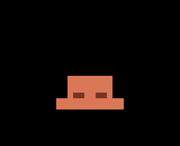

# Claude Meter

**English** · [Italiano](docs/README.it.md)

GNOME Shell extension that shows your **Claude subscription usage** and your **Claude Code** activity in the top bar.



> **Requires a paid Claude subscription (Pro or Max)** signed in through Claude Code.
> Without a subscription (free account, API key only, or Claude Code never signed in) the extension
> cannot read any usage data and stays in an error state (yellow message in the menu).

## Features

- **Top bar**: two rings for the 5-hour and weekly plan limits, plus an animated Clawd for each open Claude Code session (sleeping when idle, working while Claude is busy). Extra sessions are counted as "+N".
- **Menu**:
  - plan usage with bars, time until each reset and age of the data;
  - "Details" page: chart of the last 7 days and today's Claude Code input/output tokens (cache tokens excluded).
- **Preferences**:
  - appearance (language, colours: system accent or green/yellow/red thresholds);
  - top bar contents (rings, Clawds, how many, what to show with no session);
  - refresh intervals.
- **Conversations page**: lists the Claude Code conversations grouped by project, with size and last use; selected conversations (or whole projects) can be moved to the **system trash**, linked data included. Conversations in progress cannot be deleted.
- Italian and English interface (follows the desktop language until you choose one).

## Requirements

- GNOME Shell 50.
- [Claude Code](https://claude.com/claude-code) signed in with a **Claude Pro or Max** account (`~/.claude/.credentials.json` must exist).

## Installation

From [extensions.gnome.org](https://extensions.gnome.org) (search "Claude Meter"), or from source:

```bash
git clone https://github.com/grillofrancesco/claude-meter.git
cd claude-meter
./install.sh
# Wayland: log out and back in, then
gnome-extensions enable claude-meter@grillofra
```

Uninstall: `gnome-extensions uninstall claude-meter@grillofra`. Local history is kept in `~/.local/share/claude-meter/` (delete it by hand if you want).

## Privacy

- The plan percentages come from `https://api.anthropic.com/api/oauth/usage`, the same endpoint Claude Code uses for `/usage`. The request is authenticated with the Claude Code OAuth token, which is **only read**: never stored elsewhere, refreshed, logged or sent to anyone other than Anthropic.
- Token counts and sessions are read locally from `~/.claude/projects/` and `~/.claude/sessions/`. Message contents are never stored or logged.
- No telemetry, no other network connections.
- The 30-day history is saved in `~/.local/share/claude-meter/state.json` (mode 0600).

## Notes and limitations

- If the token has expired, the menu says the data is out of date: using Claude Code refreshes it.
- The endpoint is rate-limited: the plan is refreshed every 5 minutes (configurable) and when the menu opens if the data is older than 60 s. After a "429 Too many requests" the extension waits (5 → 30 min, or the server's `Retry-After`) and shows the next attempt time.
- Local token counts cover Claude Code only; the plan percentage includes every Claude surface (web, desktop, mobile).
- The history starts from the first run and only includes records still present in Claude Code's files.

## Development

- Styles: `styles/base.css` + `styles/dark.css` / `styles/light.css`; `./build.sh` generates `stylesheet-dark.css` / `stylesheet-light.css` and packs the extension into `dist/` (the zip uploaded to extensions.gnome.org).
- Tests of the pure modules: `bash tests/run-all.sh`.
- UI strings: always `t('area.section.name')` from `lib/i18n.js`, translations in `lib/locale/<area>.js`.
- Clawd animations: PNG spritesheets in `clawd-animation/`, converted to `lib/sprites.js` by `gjs -m tools/build-animations.js install`. See [`docs/SPRITES.md`](docs/SPRITES.md).
- GNOME Shell extensions do not hot-reload: `dev/nested.sh start` runs an isolated headless GNOME Shell (needs `mutter-devkit`) with the extension; `eval`, `shot`, `log`, `stop` to inspect it.

## License

[GPL-3.0-or-later](LICENSE). Forks and modifications are welcome, under the same license.

Claude Meter is an independent project, **not affiliated with or endorsed by Anthropic**. Claude, Claude Code and Clawd are trademarks of Anthropic.
