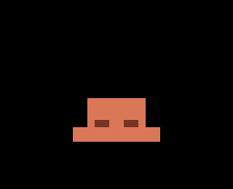

# Claude Meter

[English](../README.md) · **Italiano**

Estensione GNOME Shell che mostra nella barra superiore l'**utilizzo del tuo abbonamento Claude** e l'attività di **Claude Code**.



> **Serve un abbonamento Claude a pagamento (Pro o Max)** con accesso effettuato da Claude Code.
> Senza abbonamento (account gratuito, solo chiave API, o Claude Code mai autenticato) l'estensione
> non può leggere alcun dato di utilizzo e resta in stato di errore (messaggio giallo nel menu).

## Funzionalità

- **Barra superiore**: due anelli per i limiti del piano a 5 ore e settimanale, più un Clawd animato per ogni sessione di Claude Code aperta (dorme quando è inattiva, lavora mentre Claude è occupato). Le sessioni in più sono contate come "+N".
- **Menu**:
  - utilizzo del piano con barre, tempo al reset ed età del dato;
  - pagina "Dettagli": grafico degli ultimi 7 giorni e token di input/output di Claude Code di oggi (token di cache esclusi).
- **Preferenze**:
  - aspetto (lingua, colori: accento di sistema oppure verde/giallo/rosso in base alle soglie);
  - contenuto della barra superiore (anelli, Clawd, quanti, cosa mostrare senza sessioni);
  - intervalli di aggiornamento.
- **Pagina Conversazioni**: elenca le conversazioni di Claude Code raggruppate per progetto, con dimensione e ultimo utilizzo; le conversazioni selezionate (o interi progetti) si possono spostare nel **cestino di sistema**, dati collegati inclusi. Le conversazioni in corso non si possono eliminare.
- Interfaccia in italiano e inglese (segue la lingua del desktop finché non ne scegli una).

## Requisiti

- GNOME Shell 50.
- [Claude Code](https://claude.com/claude-code) autenticato con un account **Claude Pro o Max** (deve esistere `~/.claude/.credentials.json`).

## Installazione

Da [extensions.gnome.org](https://extensions.gnome.org) (cerca "Claude Meter"), oppure dai sorgenti:

```bash
git clone https://github.com/grillofrancesco/claude-meter.git
cd claude-meter
./install.sh
# Wayland: esci e rientra nella sessione, poi
gnome-extensions enable claude-meter@grillofra
```

Disinstallazione: `gnome-extensions uninstall claude-meter@grillofra`. Lo storico locale resta in `~/.local/share/claude-meter/` (cancellalo a mano se vuoi).

## Privacy

- Le percentuali del piano arrivano da `https://api.anthropic.com/api/oauth/usage`, lo stesso endpoint che Claude Code usa per `/usage`. La richiesta è autenticata con il token OAuth di Claude Code, che viene **solo letto**: mai salvato altrove, rinnovato, scritto nei log o inviato ad altri che non siano Anthropic.
- Token e sessioni sono letti in locale da `~/.claude/projects/` e `~/.claude/sessions/`. Il contenuto dei messaggi non viene mai salvato né scritto nei log.
- Nessuna telemetria, nessun'altra connessione di rete.
- Lo storico di 30 giorni è salvato in `~/.local/share/claude-meter/state.json` (permessi 0600).

## Note e limitazioni

- Se il token è scaduto, il menu segnala che i dati non sono aggiornati: basta usare Claude Code per rinnovarlo.
- L'endpoint ha un limite di richieste: il piano si aggiorna ogni 5 minuti (configurabile) e all'apertura del menu se il dato ha più di 60 s. Dopo un "429 Too many requests" l'estensione attende (5 → 30 min, o il `Retry-After` del server) e mostra l'orario del prossimo tentativo.
- I token locali riguardano solo Claude Code; la percentuale del piano include tutte le superfici Claude (web, desktop, mobile).
- Lo storico parte dal primo avvio e include solo i record ancora presenti nei file di Claude Code.

## Sviluppo

- Stili: `styles/base.css` + `styles/dark.css` / `styles/light.css`; `./build.sh` genera `stylesheet-dark.css` / `stylesheet-light.css` e crea il pacchetto in `dist/` (lo zip da caricare su extensions.gnome.org).
- Test dei moduli puri: `bash tests/run-all.sh`.
- Testi dell'interfaccia: sempre `t('area.sezione.nome')` da `lib/i18n.js`, traduzioni in `lib/locale/<area>.js`.
- Animazioni dei Clawd: spritesheet PNG in `clawd-animation/`, convertiti in `lib/sprites.js` da `gjs -m tools/build-animations.js install`. Vedi [`SPRITES.it.md`](SPRITES.it.md).
- Le estensioni GNOME Shell non si ricaricano a caldo: `dev/nested.sh start` avvia una GNOME Shell headless isolata (richiede `mutter-devkit`) con l'estensione; `eval`, `shot`, `log`, `stop` per ispezionarla.

## Licenza

[GPL-3.0-or-later](../LICENSE). Fork e modifiche sono benvenuti, con la stessa licenza.

Claude Meter è un progetto indipendente, **non affiliato né approvato da Anthropic**. Claude, Claude Code e Clawd sono marchi di Anthropic.
